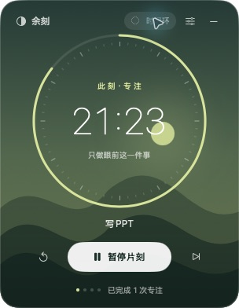
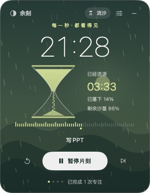

# 余刻 · Still

**一扇留在桌面角落的时间小窗。**

免费的原生 macOS 悬浮番茄钟，用逐渐缩短的时间环与持续流动的沙漏，让时间的流逝变得可见。无需账户、无需订阅、完全离线，无第三方运行时依赖。

[下载最新版](https://github.com/Jay-Jean/Still/releases/latest) · [反馈问题](https://github.com/Jay-Jean/Still/issues) · [MIT 开源许可](LICENSE)

<p>
  
  
</p>

## 下载与安装

1. 在 [Releases](https://github.com/Jay-Jean/Still/releases/latest) 下载 **Still-v1.1.2-macOS-universal.zip**。`Source code` 是源码压缩包，普通用户请选择应用包。
2. 解压后，将 **余刻.app** 拖入「应用程序」，双击启动。
3. 点击「开始专注」。应用位于菜单栏，不占用 Dock；右上角减号可收起小窗，从菜单栏重新显示或退出。

**系统要求：macOS 14 或更新版本。** Universal 应用包同时包含 Apple Silicon（M 系列）与 Intel 版本。

应用目前使用本地临时签名，尚未经过 Apple Developer ID 签名与公证。首次打开时 macOS 可能阻止运行；确认下载自本仓库后，可按系统提示到「系统设置 → 隐私与安全性」选择「仍要打开」，或自行从源码构建。

## 两种时间呈现方式

### 时间环

圆环随剩余时间逐渐缩短，太阳随本段进度慢慢落下。适合希望界面安静、偶尔瞥一眼时间的人。

### 流沙

全窗细沙持续下落，中央沙漏将上方的沙逐渐转移为下方的沙堆。放大的倒计时、已流逝分秒、沙量比例与每秒推进的刻度，提供更明显的时间反馈。

沙量依据实际可见轮廓的面积计算：流逝 25% 的时间，上方剩 75%、下方积累 25%，总沙量保持不变。沙量按整段时长变化，细沙运动提供连续反馈。暂停时所有流沙动画一起冻结。

点击右上角「时间环 / 流沙」随时切换，不会重置或暂停计时，选择会自动记住。

## 功能

- 默认 **25 分钟专注 + 5 分钟休息**；支持调整专注与休息时长。
- 专注结束自动进入休息；休息结束后，等待你开启下一段。
- 小窗置顶、跨桌面显示，可拖动空白处移动，也可从菜单栏选择四个角落。
- 暂停、继续、重置、切换阶段；手动切换不会增加已完成次数。
- 输入当前目标，选择日落 / 海湾 / 青山三种配色，开关结束提示音。
- 菜单栏显示剩余时间，收起小窗后继续计时。
- 本地保存计时进度、目标、偏好与窗口位置。
- 按真实经过的时间计时，休眠或退出后重新打开仍能恢复；不会把离开期间虚构成多轮专注。

「已完成」是本机累计完成次数。调整时长会重置当前阶段。提示音依赖系统音量；系统安全界面或独占全屏应用可能遮挡悬浮窗。

## 隐私

应用不请求网络、不包含广告或分析 SDK，不收集或上传数据。目标与计时状态仅保存在本机的用户偏好设置中。项目源码与发布包不包含开发者的个人计时数据。

## 从源码构建

需要 macOS、Swift 6 或更新版本，以及 Apple Command Line Tools 或 Xcode。应用最低运行系统为 macOS 14。

```sh
git clone https://github.com/Jay-Jean/Still.git
cd Still
bash scripts/build.sh
open dist/余刻.app
```

构建同时支持两种芯片的 Universal 应用：

```sh
STILL_UNIVERSAL=1 bash scripts/build.sh
```

输出为 `dist/余刻.app`。生成可分享的压缩包：

```sh
ditto -c -k --sequesterRsrc --keepParent dist/余刻.app dist/Still-macOS-universal.zip
```

## 检查

```sh
swift run CoreChecks
```

检查涵盖暂停恢复、阶段切换、长时间休眠恢复、状态持久化，以及 0–100% 共 101 个进度点上的沙量守恒、逐秒转移、上下沙面变化和空满状态。不依赖 XCTest，仅需 Command Line Tools。

生成使用相同沙形轮廓的五阶段核对图：

```sh
swiftc Sources/StillCore/SandGeometry.swift scripts/sand-proof.swift -o .build/sand-proof
.build/sand-proof dist/sand-volume-proof.png
```

## 源码结构

| 路径 | 用途 |
| --- | --- |
| `Sources/Still/App.swift` | 悬浮窗口、菜单栏、计时界面与设置 |
| `Sources/Still/SandTimer.swift` | 流沙动画与沙漏绘制 |
| `Sources/StillCore/Session.swift` | 计时与状态恢复 |
| `Sources/StillCore/SandGeometry.swift` | 沙量守恒与沙堆轮廓 |
| `Tests/StillCoreTests/` | 可独立运行的检查 |
| `scripts/build.sh` | 应用打包、图标与本地签名 |

欢迎通过 [Issues](https://github.com/Jay-Jean/Still/issues) 反馈问题或提交 Pull Request。代码按 [MIT License](LICENSE) 开源。
